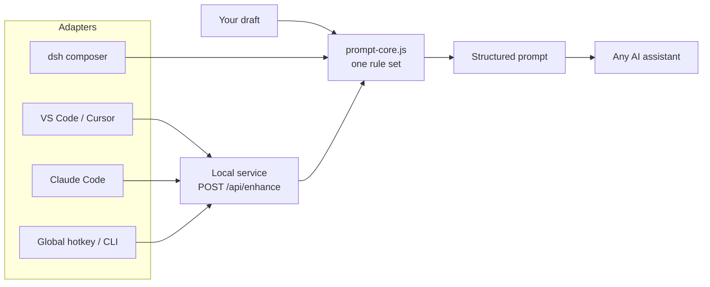
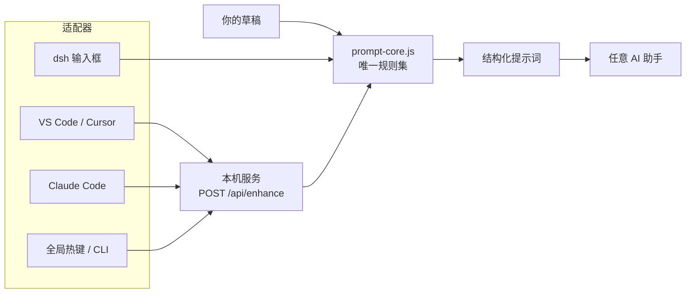

<p align="center">
  
</p>

<h1 align="center">Prompt Spark · 提示词火花</h1>

<p align="center">
  把模糊的想法，变成 AI 真正能执行的结构化提示词。<br>
  Turn rough ideas into structured prompts an AI can actually execute.
</p>

<p align="center">
  
  
  
  
</p>

<p align="center">
  <a href="#english"><b>English</b></a> ·
  <a href="#中文"><b>中文</b></a> ·
  <a href="README.zh.md">中文单独版</a>
</p>

---

<a id="english"></a>

# English

## Why Prompt Spark

Most prompt tools make a prompt *sound* better. Prompt Spark makes it **executable**: the result is structured enough for a downstream model to parse, and natural enough for a human to read.

One core, many entry points:

- a native **composer button** in DeepSeek Harness;
- a **bottom-panel button** in VS Code and Cursor;
- a **`/enhance` command** in Claude Code;
- a **global hotkey** for ChatGPT Desktop, Claude Desktop, or any other app.

Nothing is sent automatically. You always review the result first.

## Highlights

| | Feature | What it does |
| :---: | --- | --- |
| 🧩 | **Machine-readable skeleton** | Emits `Task:`, `Requirements:`, `Acceptance criteria:`, `Constraints:`, and at the detailed level `Context:` / `Failure cases:`. Plain text, not Markdown or JSON. |
| 🎚️ | **Three detail levels** | `concise` polishes only · `standard` adds proportional structure (default) · `detailed` expands boundaries and acceptance criteria. |
| 🗂️ | **Project-aware (DSH)** | Reads `AGENTS.md`, `CLAUDE.md`, `README.md`, `README.zh.md` and `package.json` from the session workspace as reference data. |
| 🎭 | **Reusable personas** | Save *how* prompts should be rewritten — product, engineering, writing, minimal — and reuse them across sessions. |
| 👀 | **Editable preview** | Review and edit the full result before replacing the draft; five-entry history and ten-second undo. |
| 🌐 | **Cross-harness** | One local service powers every adapter; the same rules everywhere. |

## Harness support

| Harness | Button inside its own composer? | How it works |
| --- | :---: | --- |
| **dsh** | ✅ | Native composer toolbar — `强化提示词` |
| **VS Code** | ➖ | Bottom-panel webview with a ✨ button, selection command and `Ctrl+Alt+E` |
| **Cursor** | ➖ | Same VSIX as VS Code |
| **Claude Code** | ➖ | `/enhance` slash command, optional `UserPromptSubmit` hook |
| **ChatGPT Desktop** | ➖ | Windows global hotkey + clipboard |
| **Any other app** | ➖ | Windows global hotkey, CLI, or the local HTTP API |

> Only dsh can place a button **inside** its own composer. Every other harness is limited by its host's extension API; the table shows the closest equivalent.

## Quick start

### dsh

The plugin is a normal DSH bundle. Install the source directory through the DSH plugin manager, then restart DSH.

```yaml
- id: prompt-enhancer-plus
  name: dsh-prompt-enhancer-plus
  config:
    maxInputChars: 12000
    maxOutputTokens: 3000
    timeoutMs: 90000
```

Write a draft, click **强化提示词** in the composer toolbar, review the result, then **替换草稿** or **复制**.

### Desktop companion (required by every non-DSH adapter)

```sh
npm install --ignore-scripts
npm run desktop
```

On Windows you can also double-click `启动通用窗口.cmd`. The companion listens on a random loopback-only `127.0.0.1` port and writes:

```text
%APPDATA%/prompt-enhancer-plus-local/session.json
{ "origin": "http://127.0.0.1:<port>", "token": "<bearer token>", "pid": 1234, "version": "1.6.0", "startedAt": "..." }
```

Keep the terminal running. Stop it with **Quit** or `Ctrl+C`.

### VS Code / Cursor

```sh
cd vscode-extension
npx @vscode/vsce package --allow-missing-repository
code   --install-extension prompt-spark-vscode-1.0.0.vsix
cursor --install-extension prompt-spark-vscode-1.0.0.vsix
```

- Open the **提示词强化** panel in the Panel area, type, choose a detail level, click **✨ 强化**.
- Select text and press `Ctrl+Alt+E` (`Cmd+Alt+E` on macOS) to replace the selection.
- Run `Prompt Spark: 输入草稿并强化` to insert at the cursor.

### Claude Code

```sh
cp .claude/commands/enhance.md <project>/.claude/commands/enhance.md
```

Then use:

```text
/enhance 帮我做一个导出 CSV 的功能
```

Optional: `claude-code/hooks/user-prompt-submit.mjs` appends the structured version as additional context (`PROMPT_SPARK_HOOK=1`). Hooks cannot replace prompt text — that is a Claude Code limitation.

### Any app — Windows global hotkey

```powershell
hotkey-tool\start-hotkey.cmd
```

Select text in ChatGPT Desktop, Claude Desktop, or any application, press `Ctrl+Alt+E`, then paste. The tool writes the result to the clipboard and **never auto-pastes**.

### CLI

```sh
echo "帮我做一个导出 CSV 的功能" | node cli/enhance.mjs --level detailed
node cli/enhance.mjs --text "..." --context-file AGENTS.md --copy
```

`stdout` contains only the enhanced text, so it composes with pipelines. Use `--json` for the full result object.

## How it works



Outside dsh, every adapter talks to the same local service. The service owns the model call and reuses `prompt-core.js`; adapters only move text in and out.

## Output contract

The same draft at three levels:

```text
concise
Task: 做一个导出 CSV 的功能。
Requirements: 1. 可选择导出字段；2. 支持 UTF-8。

standard
Task: 做一个导出 CSV 的功能。
Requirements: 1. 可选择导出字段；2. 支持 UTF-8。
Acceptance criteria: 导出文件能在 Excel 中正常打开，字段与选择一致。
Constraints: 不修改现有数据结构。

detailed
Task: 做一个导出 CSV 的功能。
Context: 现有系统已支持列表筛选，导出需复用筛选结果。
Requirements: 1. 可选择导出字段；2. 支持 UTF-8；3. 大数据量分批写入。
Acceptance criteria: 导出文件能在 Excel 中正常打开；字段与选择一致；10 万行内不超时。
Constraints: 不修改现有数据结构；不新增第三方依赖。
Failure cases: 无数据时导出空文件并提示；字段全不选时按钮禁用。
```

Design rules:

- labels stay **English** as stable machine anchors, even when the content is Chinese;
- the prose after each label follows the user's language;
- sections without real content are omitted — no empty placeholders;
- no JSON/YAML/XML unless the draft explicitly requests a machine format;
- item count stays proportional to the source; no padding.

## Local API

```text
POST /api/enhance   { text, mode?, level?, format?, personaId?, direction?, context? }
                    → { ok: true, value: { enhanced, mode, level, format, model, usage, elapsedMs } }
POST /api/health    → { ok: true, value: { ready: true, version } }
```

Every `/api/*` call requires:

- `Authorization: Bearer <token>` from `session.json`;
- `Origin: <origin>` exactly equal to the session origin;
- `Host: 127.0.0.1:<port>`.

No CORS, no LAN binding. `context` is capped at 8000 characters; unknown `level` falls back to `standard`.

## Project-aware enhancement (dsh)

The DSH host reads these files from the session workspace, in order:

`AGENTS.md` → `CLAUDE.md` → `README.md` → `README.zh.md` → `package.json`

| Rule | Value |
| --- | --- |
| Per-file limit | 6000 characters |
| Total limit | 8000 characters |
| Injection point | system prompt, labelled as **reference data only** |
| Task message | never receives project context |
| Failure behaviour | silently degrades to no context |

The preview panel has a **项目感知** toggle; the `prompt_enhancer` tool accepts `useProject`.

## Development

```sh
npm install --ignore-scripts
npm test
npm run desktop:smoke
npm pack --dry-run
```

`npm test` runs nine suites without Electron and without calling a real model:

| Suite | Covers |
| --- | --- |
| `test-core` | rules, levels, symbol preservation |
| `test-host` | DSH host/tool compatibility |
| `test-personas` | persona persistence and conflicts |
| `test-client` | client state machine |
| `test-features` | project context and three levels |
| `desktop/test-server` | loopback API security and contract |
| `desktop/test-desktop` | desktop UI logic |
| `vscode-extension/test-client` | VS Code client contract |
| `hotkey-tool/test-cli` | CLI and discovery file |

## Privacy

- No other application's composer, clipboard history, credentials, or login is read.
- Only an explicit **enhance** action sends the draft and directions to the model API you configured.
- The local service binds to loopback only, checks exact `Host`/`Origin`, and uses a random bearer token.
- The desktop companion stores model configuration and explicitly authored directions — not task history.
- Keys stay in process memory in browser mode; the optional Electron entry can use OS secure storage, and refuses plaintext fallback.

## Known limitations

- Only dsh can put a button inside its native composer. The other integrations are panel/command/hotkey equivalents.
- The VS Code extension is built locally as a VSIX; it is not published to the Marketplace.
- The Windows hotkey tool requires PowerShell 7 and passes the selection as a command-line argument, so extremely long selections can hit the Windows argument limit — use the CLI with stdin for very long drafts.
- The Claude Code hook can add context but cannot replace the submitted prompt.
- Structured output is enforced by generation instructions, not by a deterministic parser; a model may occasionally deviate.
- Not visually verified in this working copy: real VS Code/Cursor windows, a real pressed global hotkey, Claude Code slash-command execution. The Electron entry still fails natively with `0x80000003`.

## License

MIT © Erfan817

---

<a id="中文"></a>

# 中文

## 为什么是 Prompt Spark

大多数提示词工具只是让提示词“读起来更顺”。Prompt Spark 追求的是**可执行**：结果既结构化到下游模型能稳定解析，又自然到人可以直接阅读。

一个核心，多个入口：

- DeepSeek Harness 里的原生**输入框按钮**；
- VS Code / Cursor 里的**底部面板按钮**；
- Claude Code 里的 **`/enhance` 命令**；
- ChatGPT 桌面版、Claude 桌面版或任意软件的**全局热键**。

不会自动发送任何内容，结果永远先给你确认。

## 功能亮点

| | 能力 | 说明 |
| :---: | --- | --- |
| 🧩 | **机器可解析的骨架** | 输出 `Task:`、`Requirements:`、`Acceptance criteria:`、`Constraints:`，详细档再增加 `Context:` / `Failure cases:`。纯文本，不是 Markdown 或 JSON。 |
| 🎚️ | **三档详细度** | `简洁` 只润色 · `标准` 适度补充结构（默认） · `详细` 展开边界与验收标准。 |
| 🗂️ | **项目感知（DSH）** | 从会话工作区读取 `AGENTS.md`、`CLAUDE.md`、`README.md`、`README.zh.md`、`package.json` 作为参考数据。 |
| 🎭 | **可复用强化人格** | 保存“怎么改写”的方向 —— 产品、工程、写作、极简 —— 跨会话复用。 |
| 👀 | **可编辑预览** | 替换草稿前可全文审阅和修改；五条最近记录、十秒撤销。 |
| 🌐 | **跨 harness** | 一个本机服务支撑所有适配器，规则只有一套。 |

## 各 harness 支持情况

| Harness | 原生输入框内按钮 | 使用方式 |
| --- | :---: | --- |
| **dsh** | ✅ | 原生 composer 工具栏 —— `强化提示词` |
| **VS Code** | ➖ | 底部面板 webview + ✨ 按钮、选中文本命令、`Ctrl+Alt+E` |
| **Cursor** | ➖ | 与 VS Code 同一个 VSIX |
| **Claude Code** | ➖ | `/enhance` 斜杠命令，可选 `UserPromptSubmit` hook |
| **ChatGPT 桌面版** | ➖ | Windows 全局热键 + 剪贴板 |
| **其他任意软件** | ➖ | 全局热键、CLI 或本机 HTTP API |

> 只有 dsh 能把按钮**放进自己的输入框**。其他 harness 受宿主扩展 API 限制，表格给出的是最接近的等价方案。

## 快速开始

### dsh

插件就是普通的 DSH bundle。通过 DSH 插件管理器安装源码目录，然后重启 DSH。

```yaml
- id: prompt-enhancer-plus
  name: dsh-prompt-enhancer-plus
  config:
    maxInputChars: 12000
    maxOutputTokens: 3000
    timeoutMs: 90000
```

写下草稿，点击输入框工具栏的 **强化提示词**，审阅结果后选择 **替换草稿** 或 **复制**。

### 桌面伴侣（所有非 DSH 适配器都需要它）

```sh
npm install --ignore-scripts
npm run desktop
```

Windows 上也可以双击 `启动通用窗口.cmd`。服务只监听随机的 `127.0.0.1` 回环端口，并写入：

```text
%APPDATA%/prompt-enhancer-plus-local/session.json
{ "origin": "http://127.0.0.1:<port>", "token": "<bearer token>", "pid": 1234, "version": "1.6.0", "startedAt": "..." }
```

保持终端运行；在界面点 **退出** 或按 `Ctrl+C` 结束。

### VS Code / Cursor

```sh
cd vscode-extension
npx @vscode/vsce package --allow-missing-repository
code   --install-extension prompt-spark-vscode-1.0.0.vsix
cursor --install-extension prompt-spark-vscode-1.0.0.vsix
```

- 在 Panel 区打开 **提示词强化** 面板，输入草稿、选择详细度，点 **✨ 强化**。
- 选中文字按 `Ctrl+Alt+E`（macOS 为 `Cmd+Alt+E`）替换选区。
- 运行 `Prompt Spark: 输入草稿并强化` 在光标处插入结果。

### Claude Code

```sh
cp .claude/commands/enhance.md <项目>/.claude/commands/enhance.md
```

然后使用：

```text
/enhance 帮我做一个导出 CSV 的功能
```

可选：`claude-code/hooks/user-prompt-submit.mjs` 会把结构化版本作为附加上下文（需 `PROMPT_SPARK_HOOK=1`）。hook 不能替换用户原文 —— 这是 Claude Code 的平台限制。

### 任意软件 —— Windows 全局热键

```powershell
hotkey-tool\start-hotkey.cmd
```

在 ChatGPT 桌面版、Claude 桌面版或任何软件中选中文字，按 `Ctrl+Alt+E`，然后粘贴。工具只把结果写入剪贴板，**绝不自动粘贴**。

### CLI

```sh
echo "帮我做一个导出 CSV 的功能" | node cli/enhance.mjs --level detailed
node cli/enhance.mjs --text "..." --context-file AGENTS.md --copy
```

`stdout` 只输出强化结果，便于管道组合；`--json` 输出完整结果对象。

## 工作原理



除 dsh 外，所有适配器都调用同一个本机服务。模型调用与规则由服务统一负责，适配器只负责把文字送进去、把结果带回来。

## 输出契约

同一段草稿的三档输出：

```text
简洁
Task: 做一个导出 CSV 的功能。
Requirements: 1. 可选择导出字段；2. 支持 UTF-8。

标准
Task: 做一个导出 CSV 的功能。
Requirements: 1. 可选择导出字段；2. 支持 UTF-8。
Acceptance criteria: 导出文件能在 Excel 中正常打开，字段与选择一致。
Constraints: 不修改现有数据结构。

详细
Task: 做一个导出 CSV 的功能。
Context: 现有系统已支持列表筛选，导出需复用筛选结果。
Requirements: 1. 可选择导出字段；2. 支持 UTF-8；3. 大数据量分批写入。
Acceptance criteria: 导出文件能在 Excel 中正常打开；字段与选择一致；10 万行内不超时。
Constraints: 不修改现有数据结构；不新增第三方依赖。
Failure cases: 无数据时导出空文件并提示；字段全不选时按钮禁用。
```

设计规则：

- 标签固定为**英文**，作为稳定的机器锚点，即使正文是中文；
- 标签后的正文跟随用户语言；
- 没有真实内容的小节直接省略，不写空占位；
- 除非草稿明确要求机器格式，否则不输出 JSON/YAML/XML；
- 条目数量与原文字数成比例，不堆砌。

## 本机 API

```text
POST /api/enhance   { text, mode?, level?, format?, personaId?, direction?, context? }
                    → { ok: true, value: { enhanced, mode, level, format, model, usage, elapsedMs } }
POST /api/health    → { ok: true, value: { ready: true, version } }
```

每个 `/api/*` 请求都必须携带：

- `Authorization: Bearer <token>`，来自 `session.json`；
- `Origin: <origin>`，必须与会话 origin 完全一致；
- `Host: 127.0.0.1:<port>`。

不开放 CORS，不监听局域网。`context` 上限 8000 字符；未知 `level` 回退 `standard`。

## 项目感知（dsh）

DSH Host 按顺序从会话工作区读取：

`AGENTS.md` → `CLAUDE.md` → `README.md` → `README.zh.md` → `package.json`

| 规则 | 取值 |
| --- | --- |
| 单文件上限 | 6000 字符 |
| 总上限 | 8000 字符 |
| 注入位置 | system 提示词，标记为**仅参考数据** |
| 任务消息 | 永远不会包含项目上下文 |
| 失败行为 | 静默降级为无上下文 |

预览面板有 **项目感知** 开关；`prompt_enhancer` 工具支持 `useProject`。

## 开发与测试

```sh
npm install --ignore-scripts
npm test
npm run desktop:smoke
npm pack --dry-run
```

`npm test` 共九套测试，不需要 Electron，也不调用真实模型：

| 测试 | 覆盖内容 |
| --- | --- |
| `test-core` | 规则、三档、符号保真 |
| `test-host` | DSH Host / Tool 兼容 |
| `test-personas` | 人格持久化与冲突 |
| `test-client` | 客户端状态机 |
| `test-features` | 项目上下文与三档 |
| `desktop/test-server` | 本机 API 安全与契约 |
| `desktop/test-desktop` | 桌面 UI 逻辑 |
| `vscode-extension/test-client` | VS Code 客户端契约 |
| `hotkey-tool/test-cli` | CLI 与发现文件 |

## 隐私

- 不读取其他软件的输入框、剪贴板历史、凭据或登录信息。
- 只有你明确点击**强化**时，才会把草稿和方向发送给你配置的模型 API。
- 本机服务只监听回环地址，严格校验 `Host` / `Origin`，并使用随机 Bearer 令牌。
- 桌面伴侣只保存模型配置和你明确填写的方向，不保存任务历史。
- 浏览器模式下 Key 只保留在进程内存；可选 Electron 入口可使用系统安全存储，并拒绝明文回退。

## 已知限制

- 只有 dsh 能把按钮放进原生输入框；其他集成都属于面板/命令/热键的等价方案。
- VS Code 扩展以本地构建的 VSIX 分发，未发布到 Marketplace。
- Windows 热键工具需要 PowerShell 7，且会把选区作为命令行参数传递，极长的选文可能触及 Windows 参数长度限制 —— 超长草稿请用 CLI 走 stdin。
- Claude Code 的 hook 只能附加上下文，不能替换提交的原文。
- 结构化输出由生成指令约束，不是确定性解析器；模型仍可能偶尔偏离。
- 本次工作区未做视觉验证：真实 VS Code / Cursor 窗口、真实按下的全局热键、Claude Code 命令执行。Electron 入口仍以 `0x80000003` 失败。

## 许可证

MIT © Erfan817
