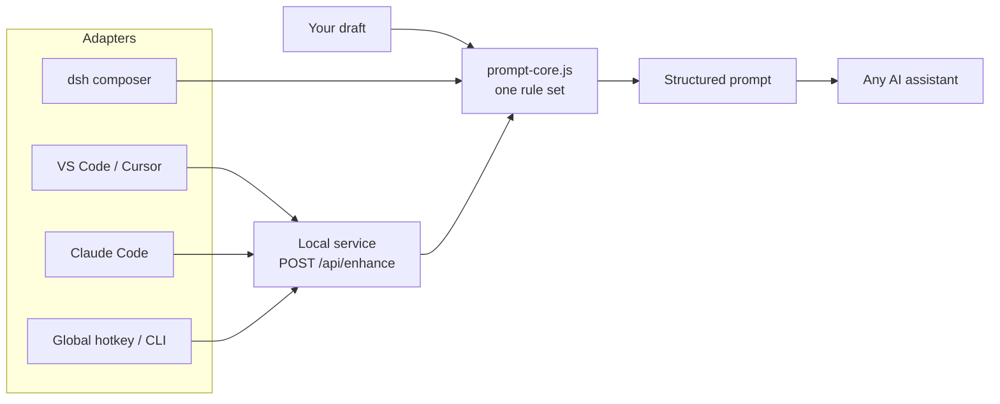

<p align="center">
  
</p>

<h1 align="center">Prompt Spark · 提示词火花</h1>

<p align="center">
  把模糊的想法，变成 AI 真正能执行的结构化提示词。<br>
  Turn rough ideas into structured prompts an AI can actually execute.
</p>

<p align="center">
  
  
  
  
</p>

<p align="center">
  <a href="README.zh.md">中文完整版</a> · <a href="README.md">Bilingual</a>
</p>

---

## 为什么是 Prompt Spark · Why Prompt Spark

**中文：** 大多数提示词工具只是让提示词“读起来更顺”。Prompt Spark 追求的是**可执行**：结果既结构化到下游模型能稳定解析，又自然到人可以直接阅读。一个核心，多个入口 —— dsh 的输入框按钮、VS Code/Cursor 的底部面板、Claude Code 的 `/enhance`、任意软件的全局热键。不会自动发送任何内容。

**English:** Most prompt tools make a prompt *sound* better. Prompt Spark makes it **executable**: structured enough for a downstream model to parse, natural enough for a human to read. One core, many entry points — a composer button in dsh, a bottom panel in VS Code/Cursor, `/enhance` in Claude Code, a global hotkey for any app. Nothing is sent automatically.

## 功能亮点 · Highlights

| | 能力 Capability | 说明 Description |
| :---: | --- | --- |
| 🧩 | 机器可解析骨架<br>Machine-readable skeleton | 输出 `Task:`、`Requirements:`、`Acceptance criteria:`、`Constraints:`，详细档再加 `Context:` / `Failure cases:`；纯文本，不是 Markdown 或 JSON。<br>Emits `Task:`, `Requirements:`, `Acceptance criteria:`, `Constraints:`, plus `Context:` / `Failure cases:` at the detailed level. Plain text, not Markdown or JSON. |
| 🎚️ | 三档详细度<br>Three detail levels | `简洁` 只润色 · `标准` 适度补充结构（默认） · `详细` 展开边界与验收标准。<br>`concise` polishes only · `standard` adds proportional structure (default) · `detailed` expands boundaries and acceptance criteria. |
| 🗂️ | 项目感知（dsh）<br>Project-aware (dsh) | 从会话工作区读取 `AGENTS.md`、`CLAUDE.md`、`README.md`、`README.zh.md`、`package.json` 作为参考数据。<br>Reads `AGENTS.md`, `CLAUDE.md`, `README.md`, `README.zh.md` and `package.json` from the session workspace as reference data. |
| 🎭 | 可复用强化人格<br>Reusable personas | 保存“怎么改写”的方向：产品、工程、写作、极简，跨会话复用。<br>Save *how* prompts should be rewritten — product, engineering, writing, minimal — and reuse them across sessions. |
| 👀 | 可编辑预览<br>Editable preview | 替换草稿前可全文审阅和修改；五条最近记录、十秒撤销。<br>Review and edit the full result before replacing the draft; five-entry history and ten-second undo. |
| 🌐 | 跨 harness<br>Cross-harness | 一个本机服务支撑所有适配器，规则只有一套。<br>One local service powers every adapter with a single rule set. |

## 各 harness 支持情况 · Harness support

| Harness | 原生输入框按钮<br>Native composer button | 使用方式<br>How it works |
| --- | :---: | --- |
| **dsh** | ✅ | 原生 composer 工具栏 —— `强化提示词`<br>Native composer toolbar — `强化提示词` |
| **VS Code** | ➖ | 底部面板 webview + ✨ 按钮、选中文本命令、`Ctrl+Alt+E`<br>Bottom-panel webview, selection command, `Ctrl+Alt+E` |
| **Cursor** | ➖ | 与 VS Code 同一个 VSIX<br>Same VSIX as VS Code |
| **Claude Code** | ➖ | `/enhance` 斜杠命令，可选 `UserPromptSubmit` hook<br>`/enhance` slash command, optional `UserPromptSubmit` hook |
| **ChatGPT Desktop** | ➖ | Windows 全局热键 + 剪贴板<br>Windows global hotkey + clipboard |
| **其他任意软件<br>Any other app** | ➖ | 全局热键、CLI 或本机 HTTP API<br>Global hotkey, CLI, or the local HTTP API |

> 只有 dsh 能把按钮**放进自己的输入框**；其他 harness 受宿主扩展 API 限制，表格给出的是最接近的等价方案。<br>
> Only dsh can place a button **inside** its own composer. Other harnesses are limited by their host extension APIs; the table shows the closest equivalent.

## 快速开始 · Quick start

### dsh

**中文：** 通过 DSH 插件管理器安装源码目录，然后重启 DSH。写下草稿，点击输入框工具栏的 **强化提示词**，审阅后选择 **替换草稿** 或 **复制**。

**English:** Install the source directory through the DSH plugin manager, then restart DSH. Write a draft, click **强化提示词** in the composer toolbar, review, then **替换草稿** or **复制**.

```yaml
- id: prompt-enhancer-plus
  name: dsh-prompt-enhancer-plus
  config:
    maxInputChars: 12000
    maxOutputTokens: 3000
    timeoutMs: 90000
```

### 桌面伴侣 · Desktop companion

**中文：** 所有非 DSH 适配器都需要它。Windows 上也可双击 `启动通用窗口.cmd`；服务只监听随机 `127.0.0.1` 回环端口。

**English:** Required by every non-DSH adapter. On Windows you can also double-click `启动通用窗口.cmd`; it listens on a random loopback-only `127.0.0.1` port.

```sh
npm install --ignore-scripts
npm run desktop
```

会话发现文件 · Session discovery file:

```text
%APPDATA%/prompt-enhancer-plus-local/session.json
{ "origin": "http://127.0.0.1:<port>", "token": "<bearer token>", "pid": 1234, "version": "1.6.0", "startedAt": "..." }
```

### VS Code / Cursor

**中文：** 在 Panel 区打开 **提示词强化** 面板，输入草稿、选择详细度，点 **✨ 强化**；选中文字按 `Ctrl+Alt+E` 替换选区；运行 `Prompt Spark: 输入草稿并强化` 在光标处插入结果。

**English:** Open the **提示词强化** panel in the Panel area, type a draft, choose a detail level, click **✨ 强化**. Select text and press `Ctrl+Alt+E` to replace the selection; run `Prompt Spark: 输入草稿并强化` to insert at the cursor.

```sh
cd vscode-extension
npx @vscode/vsce package --allow-missing-repository
code   --install-extension prompt-spark-vscode-1.0.0.vsix
cursor --install-extension prompt-spark-vscode-1.0.0.vsix
```

### Claude Code

**中文：** Claude Code 没有 UI 扩展 API，只能使用斜杠命令。复制 `.claude/commands/enhance.md` 到项目或用户级 `.claude/commands/`，然后 `/enhance 帮我做一个导出 CSV 的功能`。

**English:** Claude Code has no UI extension API, so the slash command is the official path. Copy `.claude/commands/enhance.md` to a project or user-level `.claude/commands/`, then run `/enhance 帮我做一个导出 CSV 的功能`.

可选 hook：`claude-code/hooks/user-prompt-submit.mjs` 会把结构化版本作为附加上下文（需 `PROMPT_SPARK_HOOK=1`）；hook 不能替换用户原文，这是平台限制。<br>
Optional hook: `claude-code/hooks/user-prompt-submit.mjs` appends the structured version as additional context (`PROMPT_SPARK_HOOK=1`). Hooks cannot replace prompt text — a Claude Code limitation.

### 任意软件 · Any app (Windows)

**中文：** 在 ChatGPT 桌面版、Claude 桌面版或任何软件中选中文字，按 `Ctrl+Alt+E`，然后粘贴。工具只把结果写入剪贴板，**绝不自动粘贴**。

**English:** Select text in ChatGPT Desktop, Claude Desktop, or any application, press `Ctrl+Alt+E`, then paste. The tool writes the result to the clipboard and **never auto-pastes**.

```powershell
hotkey-tool\start-hotkey.cmd
```

### CLI

**中文：** `stdout` 只输出强化结果，便于管道组合；`--json` 输出完整结果对象。

**English:** `stdout` contains only the enhanced text, so it composes with pipelines. Use `--json` for the full result object.

```sh
echo "帮我做一个导出 CSV 的功能" | node cli/enhance.mjs --level detailed
node cli/enhance.mjs --text "..." --context-file AGENTS.md --copy
```

## 工作原理 · How it works



**中文：** 除 dsh 外，所有适配器都调用同一个本机服务；模型调用与规则由服务统一负责，适配器只负责把文字送进去、把结果带回来。

**English:** Outside dsh, every adapter talks to the same local service. The service owns the model call and reuses `prompt-core.js`; adapters only move text in and out.

## 输出契约 · Output contract

同一段草稿的三档输出 · The same draft at three levels:

```text
简洁 / concise
Task: 做一个导出 CSV 的功能。
Requirements: 1. 可选择导出字段；2. 支持 UTF-8。

标准 / standard
Task: 做一个导出 CSV 的功能。
Requirements: 1. 可选择导出字段；2. 支持 UTF-8。
Acceptance criteria: 导出文件能在 Excel 中正常打开，字段与选择一致。
Constraints: 不修改现有数据结构。

详细 / detailed
Task: 做一个导出 CSV 的功能。
Context: 现有系统已支持列表筛选，导出需复用筛选结果。
Requirements: 1. 可选择导出字段；2. 支持 UTF-8；3. 大数据量分批写入。
Acceptance criteria: 导出文件能在 Excel 中正常打开；字段与选择一致；10 万行内不超时。
Constraints: 不修改现有数据结构；不新增第三方依赖。
Failure cases: 无数据时导出空文件并提示；字段全不选时按钮禁用。
```

**设计规则 · Design rules**

- 标签固定为**英文**，作为稳定的机器锚点，即使正文是中文；标签后的正文跟随用户语言。<br>*Labels stay **English** as stable machine anchors even when the content is Chinese; the prose after each label follows the user's language.*
- 没有真实内容的小节直接省略，不写空占位。<br>*Sections without real content are omitted — no empty placeholders.*
- 除非草稿明确要求机器格式，否则不输出 JSON/YAML/XML。<br>*No JSON/YAML/XML unless the draft explicitly requests a machine format.*
- 条目数量与原文字数成比例，不堆砌。<br>*Item count stays proportional to the source; no padding.*

## 本机 API · Local API

```text
POST /api/enhance   { text, mode?, level?, format?, personaId?, direction?, context? }
                    → { ok: true, value: { enhanced, mode, level, format, model, usage, elapsedMs } }
POST /api/health    → { ok: true, value: { ready: true, version } }
```

**中文：** 每个 `/api/*` 请求都必须携带 `Authorization: Bearer <token>`（来自 `session.json`）、与会话一致的 `Origin` 头，以及 `Host: 127.0.0.1:<port>`。不开放 CORS，不监听局域网；`context` 上限 8000 字符，未知 `level` 回退 `standard`。

**English:** Every `/api/*` call requires `Authorization: Bearer <token>` from `session.json`, an `Origin` header equal to the session origin, and `Host: 127.0.0.1:<port>`. No CORS, no LAN binding; `context` is capped at 8000 characters and unknown `level` falls back to `standard`.

## 项目感知 · Project-aware (dsh)

**中文：** DSH Host 按顺序读取 `AGENTS.md` → `CLAUDE.md` → `README.md` → `README.zh.md` → `package.json`，注入 system 提示词并标记为**仅参考数据**；任务消息永远不会包含项目上下文。

**English:** The DSH host reads `AGENTS.md` → `CLAUDE.md` → `README.md` → `README.zh.md` → `package.json` in order, injects them into the system prompt labelled **reference data only**; the task message never receives project context.

| 规则 Rule | 取值 Value |
| --- | --- |
| 单文件上限 · Per-file limit | 6000 字符 · characters |
| 总上限 · Total limit | 8000 字符 · characters |
| 失败行为 · Failure behaviour | 静默降级为无上下文 · silently degrades to no context |
| 开关 · Toggle | 预览面板「项目感知」/ `useProject` 工具参数 · Preview panel toggle / `useProject` tool argument |

## 开发与测试 · Development

```sh
npm install --ignore-scripts
npm test
npm run desktop:smoke
npm pack --dry-run
```

`npm test` 共九套测试，不需要 Electron，也不调用真实模型。<br>
`npm test` runs nine suites without Electron and without calling a real model.

| 测试 Suite | 覆盖内容 Covers |
| --- | --- |
| `test-core` | 规则、三档、符号保真 · rules, levels, symbol preservation |
| `test-host` | DSH Host / Tool 兼容 · host/tool compatibility |
| `test-personas` | 人格持久化与冲突 · persona persistence and conflicts |
| `test-client` | 客户端状态机 · client state machine |
| `test-features` | 项目上下文与三档 · project context and three levels |
| `desktop/test-server` | 本机 API 安全与契约 · loopback API security and contract |
| `desktop/test-desktop` | 桌面 UI 逻辑 · desktop UI logic |
| `vscode-extension/test-client` | VS Code 客户端契约 · VS Code client contract |
| `hotkey-tool/test-cli` | CLI 与发现文件 · CLI and discovery file |

## 隐私 · Privacy

- 不读取其他软件的输入框、剪贴板历史、凭据或登录信息。<br>*No other application's composer, clipboard history, credentials, or login is read.*
- 只有你明确点击**强化**时，才会把草稿和方向发送给你配置的模型 API。<br>*Only an explicit enhance action sends the draft and directions to the model API you configured.*
- 本机服务只监听回环地址，严格校验 `Host` / `Origin`，并使用随机 Bearer 令牌。<br>*The local service binds to loopback only, checks exact `Host`/`Origin`, and uses a random bearer token.*
- 桌面伴侣只保存模型配置和你明确填写的方向，不保存任务历史。<br>*The desktop companion stores model configuration and explicitly authored directions — not task history.*
- 浏览器模式下 Key 只保留在进程内存；可选 Electron 入口可使用系统安全存储，并拒绝明文回退。<br>*Keys stay in process memory in browser mode; the optional Electron entry can use OS secure storage and refuses plaintext fallback.*

## 已知限制 · Known limitations

- 只有 dsh 能把按钮放进原生输入框；其他集成都属于面板/命令/热键的等价方案。<br>*Only dsh can put a button inside its native composer; the other integrations are panel/command/hotkey equivalents.*
- VS Code 扩展以本地构建的 VSIX 分发，未发布到 Marketplace。<br>*The VS Code extension is built locally as a VSIX; it is not published to the Marketplace.*
- Windows 热键工具需要 PowerShell 7，且把选区作为命令行参数传递，极长选文可能触及 Windows 参数长度限制；超长草稿请用 CLI 走 stdin。<br>*The Windows hotkey tool requires PowerShell 7 and passes the selection as a command-line argument, so extremely long selections can hit the Windows argument limit — use the CLI with stdin for very long drafts.*
- Claude Code 的 hook 只能附加上下文，不能替换提交的原文。<br>*The Claude Code hook can add context but cannot replace the submitted prompt.*
- 结构化输出由生成指令约束，不是确定性解析器；模型仍可能偶尔偏离。<br>*Structured output is enforced by generation instructions, not a deterministic parser; a model may occasionally deviate.*
- 本次工作区未做视觉验证：真实 VS Code / Cursor 窗口、真实按下的全局热键、Claude Code 命令执行。Electron 入口仍以 `0x80000003` 失败。<br>*Not visually verified in this working copy: real VS Code/Cursor windows, a real pressed global hotkey, Claude Code slash-command execution. The Electron entry still fails natively with `0x80000003`.*

## 许可证 · License

MIT © Erfan817
