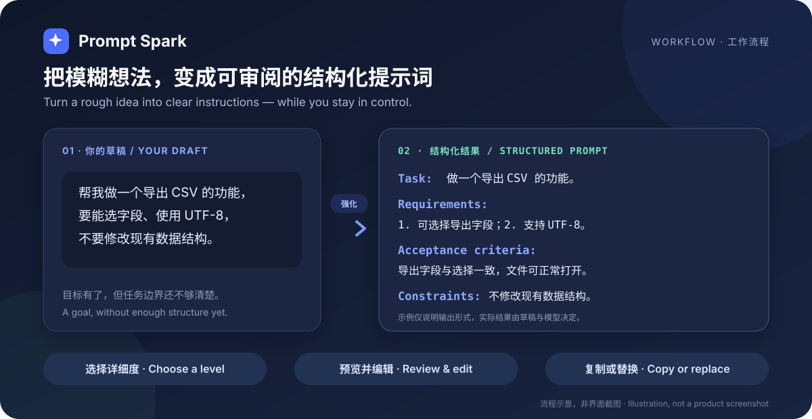
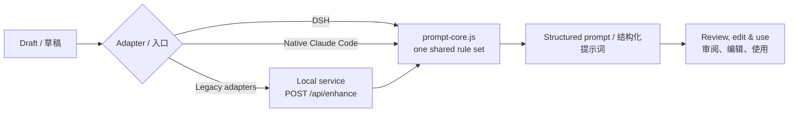

<p align="center">
  
</p>

<h1 align="center">Prompt Spark · 提示词火花</h1>

<p align="center">
  把模糊的想法，变成结构清晰、可以审阅的提示词。<br>
  Turn rough ideas into structured prompts — with you in control of the final text.
</p>

<p align="center">
  <a href="docs/release-1.7.0.md"></a>
  <a href="LICENSE"></a>
  
  
</p>

<p align="center">
  <a href="#快速开始--quick-start">快速开始</a> ·
  <a href="README.zh.md">中文摘要</a> ·
  <a href="https://github.com/Erfan817/prompt-spark">GitHub</a> ·
  <a href="https://github.com/Erfan817/prompt-spark/issues">问题反馈</a>
</p>

---

**Prompt Spark 是什么？** 它是一套开源提示词强化工具：DSH 提供原生输入框按钮；兼容构建的 Claude Code 使用原生 function hooks 插件，无需本机服务；旧适配器通过本地服务连接 VS Code、Cursor、CLI 和其他 Windows 应用。它会把草稿整理为包含任务、要求、验收标准和约束的可读文本，减少后续补充背景与边界的沟通。

**What is Prompt Spark?** It is an open-source prompt enhancement tool with a native DSH composer button, a local companion service, and thin adapters for VS Code, Cursor, Claude Code, a CLI, and other Windows apps. It turns a rough draft into readable tasks, requirements, acceptance criteria, and constraints, so you spend less time adding missing context and boundaries later.

**为什么值得使用？** 你可以选择补充多少细节，先审阅和编辑，再决定复制或替换；Prompt Spark 不会自动粘贴或替你发送结果。

**Why use it?** Choose how much detail you want, review and edit the result, then copy or replace your draft. Prompt Spark does not auto-paste or send the result for you.

<p align="center">
  
</p>

## 适合哪些场景 · When it helps

- **开发与产品需求**：把“帮我做一个导出功能”整理成任务、要求和验收标准，适合交给编码助手继续执行。<br>*Turn a vague feature request into tasks, requirements, and acceptance criteria for a coding assistant.*
- **写作、分析与日常 AI 指令**：保留原始意图，用简洁、标准或详细三档控制补充程度。<br>*Preserve your intent while choosing concise, standard, or detailed enhancement for writing and analysis.*
- **跨工具工作**：在不同 AI 工具之间复用同一套强化规则，而不必维护多份提示词模板。<br>*Reuse one rule set across AI tools instead of maintaining separate prompt templates.*

## 核心特点 · Highlights

| 能力 · Capability | 它能做什么 · What it does |
| --- | --- |
| **结构化，但仍可读**<br>*Structured, still readable* | 默认输出带 `Task:`、`Requirements:`、`Acceptance criteria:`、`Constraints:` 的纯文本；详细档可增加 `Context:` 和 `Failure cases:`。没有真实内容的小节会省略。<br>*Plain-text semantic anchors by default, with optional context and failure cases at the detailed level. Empty sections are omitted.* |
| **三档详细度**<br>*Three detail levels* | `concise` 轻度润色，`standard` 补充适度结构（默认），`detailed` 展开边界、验收标准与失败情况。<br>*Choose light polishing, proportional structure (default), or expanded boundaries and acceptance criteria.* |
| **先审阅，再使用**<br>*Review before use* | DSH 支持全文预览和编辑、最近五条记录与十秒撤销；由你决定复制或替换草稿。<br>*DSH provides an editable preview, five recent entries, and ten-second undo. You decide whether to copy or replace.* |
| **可复用人格与偏好**<br>*Reusable personas & preferences* | 保存产品、工程、写作、极简等改写方向；DSH 还能从手动修改前后的差异中提议可复用偏好，审阅后才保存。<br>*Save rewriting directions and, in DSH, review preferences inferred from your manual edits before anything is stored.* |
| **项目感知（DSH）**<br>*Project-aware (DSH)* | 可将 `AGENTS.md`、`CLAUDE.md`、`README.md`、`README.zh.md` 和 `package.json` 作为参考数据，让改写更贴合当前项目。<br>*Use project instruction and metadata files as reference data for more relevant rewrites.* |
| **一个核心，多个入口**<br>*One core, many entry points* | DSH 和 Claude Code 原生插件复用强化核心及各自宿主的模型接口；旧适配器连接本机服务，规则集中维护。<br>*DSH and native Claude Code use shared rules with host model clients; legacy adapters use the local service.* |

## 看看输出长什么样 · Example

下面只演示输出形式，实际结果由草稿和所配置的模型决定。

*This example illustrates the format, not a guaranteed model response. Actual output depends on your draft and configured model.*

**草稿 · Draft**

```text
帮我做一个导出 CSV 的功能，要能选择导出字段并使用 UTF-8，不要修改现有数据结构。
```

**标准档示例 · Standard-level example**

```text
Task: 做一个导出 CSV 的功能。
Requirements: 1. 可选择导出字段；2. 支持 UTF-8。
Acceptance criteria: 导出字段与选择一致，文件可正常打开。
Constraints: 不修改现有数据结构。
```

标签固定使用英文，作为稳定的机器锚点；标签后的正文跟随用户语言。默认不输出 JSON/YAML/XML，条目数量与原始请求成比例，避免为了“详细”而堆砌内容。

*English labels provide stable machine anchors while the prose follows the user's language. JSON/YAML/XML is not the default, empty sections are omitted, and item counts stay proportional to the request.*

## 快速开始 · Quick start

### 准备源码与依赖 · Install the source

```sh
git clone https://github.com/Erfan817/prompt-spark.git
cd prompt-spark
npm install --ignore-scripts
```

- **DSH 原生集成**：需要 DSH `>=0.2.2-rc.1`。<br>*The native DSH integration requires DSH `>=0.2.2-rc.1`.*
- **Claude Code 原生插件**：需要支持 function hooks 的宿主，不需要额外 Node 进程或本机服务。<br>*Native Claude Code requires a compatible function-hooks build, not an extra Node process or local service.*
- **桌面伴侣、CLI 与旧适配器**：需要 Node.js 22+。<br>*The companion service, CLI, and legacy adapters require Node.js 22+.*
- **Windows 全局热键**：需要 Windows 10/11 和 PowerShell 7（`pwsh`）。<br>*The global hotkey requires Windows 10/11 and PowerShell 7 (`pwsh`).*

### DSH：在输入框里直接使用 · Use the native DSH button

1. 通过 DSH 插件管理器安装源码目录，然后重启 DSH。<br>*Install the source directory through the DSH plugin manager, then restart DSH.*
2. 在输入框写下草稿，点击工具栏的 **强化提示词**。<br>*Write a draft and click **强化提示词** in the composer toolbar.*
3. 选择详细度，审阅并编辑结果，再选择 **替换草稿** 或 **复制**。<br>*Choose a detail level, review and edit, then select **替换草稿** or **复制**.*

DSH 强化默认使用当前会话选择的 provider/model，不需要启动桌面伴侣，也不会静默切换模型供应商。同时配置 `provider` 和 `model` 可以固定辅助改写路由；未配置时才跟随当前会话。

*By default, DSH enhancement reuses the current session provider/model and does not need the companion service. It never silently switches providers. Set both `provider` and `model` in the plugin configuration to pin a dedicated rewrite route; otherwise, the session route is used.*

### 非 DSH 入口：启动并配置本地服务 · Start and configure the companion

旧 VS Code/Cursor、CLI、Windows 热键和 `/enhance` 命令需要本地服务；DSH 和新的 Claude Code 原生插件不需要。在仓库根目录运行，并保持终端开启：

*Every non-DSH adapter needs the local companion. Run this from the repository root and keep the terminal open:*

```sh
npm run desktop
```

首次使用请在打开的本地窗口中进入 **设置**，确认接口类型、API 基础地址和模型 ID，并填写 API Key；本地无鉴权模型可以不填 Key。Windows 也可以双击 `启动通用窗口.cmd`。服务只监听随机 `127.0.0.1` 回环端口。

*On first use, open **设置** in the local window, confirm the API type, base URL, and model ID, then enter your API Key. A Key is optional for a local model that does not require authentication. On Windows, you can also double-click `启动通用窗口.cmd`. The service binds only to a random `127.0.0.1` loopback port.*

> **macOS / Linux 注意：** 当前服务与部分客户端对 `session.json` 的默认路径存在不一致，macOS 以及设置了自定义 `XDG_CONFIG_HOME` 的 Linux 会受影响。请先查看 [已知限制](#已知限制--known-limitations)；Windows 与使用默认 `~/.config` 的 Linux 路径一致。
>
> **macOS / Linux note:** The service and some clients currently disagree on the default `session.json` location. This affects macOS and Linux with a custom `XDG_CONFIG_HOME`; see [Known limitations](#已知限制--known-limitations). Windows and Linux using the default `~/.config` path are consistent.

### VS Code / Cursor：底部面板或快捷键 · Panel or keyboard shortcut

保持本地服务运行，再构建并安装 VSIX：

*Keep the companion running, then build and install the VSIX:*

```sh
cd vscode-extension
npx @vscode/vsce package --allow-missing-repository

# 根据所用编辑器二选一 · Choose one
code --install-extension prompt-spark-vscode-1.0.0.vsix
cursor --install-extension prompt-spark-vscode-1.0.0.vsix
```

打开 **提示词强化** 底部面板，输入草稿并点击 **✨ 强化**。也可以选中文字后按 `Ctrl+Alt+E`（macOS：`Cmd+Alt+E`）替换选区，或运行 `Prompt Spark: 输入并强化` 将结果插入光标处。

*Open the **提示词强化** bottom panel, enter a draft, and click **✨ 强化**. Alternatively, select text and press `Ctrl+Alt+E` (`Cmd+Alt+E` on macOS) to replace the selection, or run `Prompt Spark: 输入并强化` to insert at the cursor.*

详细安装、命令与故障排查见 [VS Code / Cursor 指南](vscode-extension/README.md)。<br>*See the [VS Code / Cursor guide](vscode-extension/README.md) for detailed installation, commands, and troubleshooting.*

### Claude Code：原生插件 · Native plugin

推荐 [`claude-code/native-plugin`](claude-code/native-plugin/README.md)：在输入区上方点击「✨ 强化」，审阅并编辑预览，再确认替换草稿。支持三档详细度、复制、取消与撤销，不自动发送。使用宿主当前会话模型和凭据，不需要桌面伴侣、本机 HTTP 服务或额外 API Key；强化仍消耗模型用量。

*The native function-hooks plugin adds a composer-adjacent button, editable preview and explicit draft replacement. It uses the host model client, with no companion service or separate API key. Model usage still applies.*

需要支持 `hooks.modules`、`AbovePrompt`、草稿读写及模型 completion 的 early-access 构建；不是所有 Claude Code 版本都保证兼容。开发加载和验证见 [Claude Code 指南](claude-code/README.md)。

#### 旧命令入口（可选） · Legacy slash command

1. 保持 `npm run desktop` 运行。<br>*Keep `npm run desktop` running.*
2. 将本仓库的 `.claude/commands/enhance.md` 复制到目标项目的 `.claude/commands/enhance.md`，或用户级 `~/.claude/commands/enhance.md`。如果仓库不在命令中登记的默认目录，请修改默认路径，或将 `PROMPT_SPARK_CLI` 设置为 `cli/enhance.mjs` 的绝对路径。<br>*Copy this repository's `.claude/commands/enhance.md` to the target project or your user-level `.claude/commands/` directory. If your checkout differs from the command's registered default path, edit that path or set `PROMPT_SPARK_CLI` to the absolute path of `cli/enhance.mjs`.*
3. 在 Claude Code 中运行 · *Run in Claude Code*：

```text
/enhance 帮我做一个导出 CSV 的功能，要能选字段
```

旧命令仍依赖本机服务，不是新原生插件的前置条件。可选传统 `UserPromptSubmit` hook 需显式启用，只能追加上下文，不能替换原文；不要与原生 function hooks 混淆。配置方法见 [Claude Code 指南](claude-code/README.md)。

*The legacy command still requires the companion. Classic UserPromptSubmit hooks append context; the new native plugin uses a separate function-hooks API for UI and draft access.*

### 任意 Windows 应用：全局热键 · Global hotkey for Windows apps

保持本地服务运行，然后执行 · *Keep the companion running, then execute*：

```powershell
hotkey-tool\start-hotkey.cmd
```

在目标应用中选中文字，按 `Ctrl+Alt+E`，等待结果写入剪贴板，再自行按 `Ctrl+V`。工具**不会自动粘贴或发送**。热键冲突、参数调整与故障排查见 [全局热键指南](hotkey-tool/README.md)。

*Select text in the target app, press `Ctrl+Alt+E`, wait for the result to reach the clipboard, then press `Ctrl+V` yourself. The tool **never auto-pastes or sends**. See the [hotkey guide](hotkey-tool/README.md) for conflicts, options, and troubleshooting.*

### CLI：管道与脚本 · Pipes and scripts

保持本地服务运行，然后执行 · *Keep the companion running, then execute*：

```sh
echo "帮我做一个导出 CSV 的功能" | node cli/enhance.mjs --level detailed
node cli/enhance.mjs --text "..." --context-file AGENTS.md --copy
```

`stdout` 默认只输出强化后的文本，便于管道组合；`--json` 输出完整结果对象。运行 `node cli/enhance.mjs --help` 可查看全部参数。

*By default, `stdout` contains only the enhanced text for easy piping; `--json` returns the full result object. Run `node cli/enhance.mjs --help` for every option.*

## 工作原理 · How it works



DSH 和 Claude Code 原生插件直接复用强化规则，由各自宿主执行模型调用。旧面板、CLI、热键及 `/enhance` 适配器仍调用本机服务。Claude Code 插件中的规则副本由 `npm run claude:build` 同步，`--check` 检查漂移。

*DSH and the native Claude Code plugin use host model clients and shared rules. Legacy adapters still use the loopback service. The native plugin's bundled rules are synchronized by the build script.*

## 进一步了解 · Advanced details

<details>
<summary><strong>项目感知与偏好学习（DSH） · Project context & learned preferences</strong></summary>

### 项目感知 · Project context

DSH Host 按顺序读取 `AGENTS.md` → `CLAUDE.md` → `README.md` → `README.zh.md` → `package.json`，以**仅参考数据**标记后注入 system 提示词，不写入用户任务消息。

*The DSH host reads those files in the listed order, labels them **reference data only**, and injects them into the system prompt — never into the user's task message.*

| 规则 · Rule | 取值 · Value |
| --- | --- |
| 单文件上限 · Per-file limit | 6000 字符 · characters |
| 总上限 · Total limit | 8000 字符 · characters |
| 文件缺失或不可读 · Missing/unreadable files | 静默降级为无上下文 · Silently continue without context |
| 开关 · Toggle | 预览面板「项目感知」/ `useProject` 工具参数 · Preview toggle / tool argument |

### Skill 感知（DSH） · Skill references

侧栏「参考 Skill」默认开启，与项目感知独立。读取当前会话/工作目录可见且允许模型调用的 Skill 目录，以名称、描述和触发条件做关键词匹配，只按需加载最多三个正文（每个 6000 字符，总计 12000 字符）。结果显示参考来源、截断和不可用状态。Skill 是改写参考而非要执行的任务：不运行命令、不加载引用文件，不扫描任意下载目录或自动安装 Skill。匹配为启发式，不保证同义词召回；无匹配时正常强化，无额外选择模型调用。Skill 参考会发送到当前强化模型。仅支持 DSH，已有插件更新需重启 DSH 并刷新页面。

*The independent, default-on Reference Skills switch matches the session-visible, model-invocable catalog by keywords in names, descriptions and triggers. Up to three bodies are loaded on demand (6000 characters each, 12000 total), with reference metadata shown in the preview. It does not execute Skills, follow resource links or discover arbitrary download folders. Matching is heuristic, not semantic search; no extra selection model call is made. References are sent to the enhancement model. DSH only; restart DSH and refresh the page after updating an existing installation.*

### 从编辑中学习 · Learn from edits

首次强化后，手动修改预览或已替换的输入框，再次强化时，系统可以额外调用模型，从两个版本的差异中提议一条改写习惯。你可以编辑建议、选择范围，并明确确认是否保存；取消不会保存，也不会继续强化。选择 **不保存，继续强化** 会保留已有规则并继续本次强化，但不保存新建议。

*Enhance once, edit the preview or replaced composer text, then enhance again. An additional model call can compare the versions and propose a reusable rewriting habit. You can edit the suggestion, choose its scope, and explicitly confirm whether to save it. Cancel neither saves nor continues; **Continue without saving** keeps existing rules and proceeds without storing the new suggestion.*

- **范围 · Scopes**：默认按规范化工作目录保存到项目，也可选择当前会话或当前 DSH 配置档全局；Windows 路径匹配忽略大小写。<br>*Project scope based on the normalized working directory is the default; session and DSH-profile-global scopes are also available. Windows matching is case-insensitive.*
- **生效方式 · Application**：确认后的方向用于本次及后续适用强化，不改变主助手或其他适配器。<br>*Confirmed directions apply to the immediate retry and later matching enhancements, not the main assistant or other adapters.*
- **冲突处理 · Conflicts**：不同方向必须由用户选择保留或覆盖。同范围、同键记录可替换；跨范围记录保留，仅在新规则适用处按 ID 覆盖，不会删除其他上下文仍需要的记忆。删除覆盖规则可能恢复被保留的旧方向；之后新保存的规则会重新进行冲突检查。<br>*Every different direction requires a keep/override decision. Same-scope, same-key records may be replaced; cross-scope records are retained and overridden by ID only where the new rule applies. Deleting an override can restore a retained direction, and newly saved rules undergo conflict review again.*
- **管理 · Management**：面板详情的「已保存偏好」显示生效/被覆盖状态并支持删除；工具可列出或删除，不能代替用户确认学习。<br>*The saved-preferences view shows active/overridden states and supports deletion. Tools can list or delete records but cannot confirm learning for the user.*
- **边界 · Boundaries**：连续性判断是启发式的。清空、发送、大幅替换草稿或打开历史记录会丢弃基线；基线与建议仅在主机内存保留约 30 分钟。推断会额外消耗 token，保存前应检查任务事实、名称、路径或敏感信息。<br>*Task continuity is heuristic. Clearing, sending, substantially replacing input, or opening history drops the baseline. Baselines and proposals remain in host memory for about 30 minutes. Inference consumes extra tokens; review facts, names, paths, and sensitive data before saving.*

</details>

<details>
<summary><strong>模型路由与 DSH 配置 · Model routing & DSH configuration</strong></summary>

DSH 强化默认调用当前会话的 provider/model route，辅助请求默认尝试模型支持的最低推理档（优先 `off`），默认 30 秒超时，不会自动切换供应商。同时在配置中设置 `provider` 与 `model` 可固定辅助路由；未固定时才复用会话路由。

*By default, DSH enhancement uses the current session provider/model route. It requests the lowest supported reasoning effort (preferring `off`), times out after 30 seconds, and never switches providers automatically. Configure both `provider` and `model` to pin an auxiliary route; otherwise, the session route is reused.*

如果路由返回 `Credits exhausted (429)`、只输出 reasoning 而没有正文或响应超时，请检查当前路由额度与模型输出行为，或在同一 gateway 中选择其他可用模型。提示词改写本身不能解决账户额度问题。

*If the route returns `Credits exhausted (429)`, reasoning without text, or a timeout, check route credits and model output behavior, or select another available model on the same gateway. Rewriting a prompt cannot resolve an account-credit problem.*

可选配置示例 · *Optional configuration example*：

```yaml
- id: prompt-enhancer-plus
  name: dsh-prompt-enhancer-plus
  config:
    maxInputChars: 12000
    maxOutputTokens: 3000
    timeoutMs: 30000
    reasoningEffort: off
```

</details>

<details>
<summary><strong>本机 API 与会话发现 · Local API & session discovery</strong></summary>

`npm run desktop` 提供以下接口 · *`npm run desktop` exposes*：

```text
POST /api/enhance   { text, mode?, level?, format?, personaId?, direction?, context? }
                    → { ok: true, value: { enhanced, mode, level, format, model, usage, elapsedMs } }
POST /api/health    → { ok: true, value: { ready: true, version } }
```

每个 `/api/*` 请求都必须携带 · *Every `/api/*` request requires*：

- `Authorization: Bearer <token>`，令牌来自 `session.json`；<br>*A bearer token from `session.json`.*
- 与会话一致的 `Origin`；<br>*An `Origin` matching the session origin.*
- `Host: 127.0.0.1:<port>`。<br>*The exact loopback `Host` header.*

服务不开放 CORS，不监听局域网；`context` 上限 8000 字符，未知 `level` 回退到 `standard`。

*The service enables no CORS and does not bind to the LAN. `context` is capped at 8,000 characters, and an unknown `level` falls back to `standard`.*

当前服务实际写入路径与客户端默认查找路径如下 · *The current service write path and client lookup paths are*：

| 平台 · Platform | 服务写入 · Service writes | CLI / VS Code / Claude hook 默认查找 · Default client lookup |
| --- | --- | --- |
| Windows | `%APPDATA%/prompt-enhancer-plus-local/session.json` | 同左 · Same |
| macOS | `~/.config/prompt-enhancer-plus-local/session.json` | `~/Library/Application Support/prompt-enhancer-plus-local/session.json` |
| Linux（默认 · default） | `~/.config/prompt-enhancer-plus-local/session.json` | 同左 · Same |
| Linux（自定义 · custom `XDG_CONFIG_HOME`） | 仍为 `~/.config/...` · Still `~/.config/...` | `$XDG_CONFIG_HOME/prompt-enhancer-plus-local/session.json` |

> **已知契约问题：** macOS 与自定义 `XDG_CONFIG_HOME` 的 Linux 路径不一致。CLI 可用 `--session` 显式指定服务实际写入的文件；其他受影响客户端需先统一路径。详见 [已知限制](#已知限制--known-limitations)。
>
> **Known contract issue:** These paths differ on macOS and Linux with a custom `XDG_CONFIG_HOME`. The CLI can use `--session` to point at the actual file; other affected clients need their paths aligned first. See [Known limitations](#已知限制--known-limitations).

会话文件示例 · *Example session file*：

```text
{ "origin": "http://127.0.0.1:<port>", "token": "<bearer token>", "pid": 1234, "version": "1.6.0", "startedAt": "..." }
```

`session.json` 包含本机访问令牌，请勿分享。CLI 与 VS Code/Cursor 客户端会拒绝非本机 origin，避免把令牌发送到远端；可选 Claude Code hook 直接使用文件中的 origin，当前没有这项客户端侧回环校验，因此只能使用可信的本机会话文件。

*`session.json` contains a local access token — do not share it. The CLI and VS Code/Cursor clients reject non-loopback origins to avoid sending that token remotely. The optional Claude Code hook currently uses the file's origin directly without this client-side check, so only use a trusted local session file.*

</details>

## 各入口的支持范围 · Harness support

| 入口 · Harness | 使用方式 · How it works | 原生输入框按钮 · Native composer button |
| --- | --- | :---: |
| **DSH** | Composer 工具栏的 **强化提示词**<br>*Native composer toolbar button* | ✅ |
| **VS Code** | 底部面板、选中文本命令、`Ctrl+Alt+E` / `Cmd+Alt+E`<br>*Bottom panel, selection command, keyboard shortcut* | ➖ |
| **Cursor** | 与 VS Code 共用同一个 VSIX<br>*Uses the same VSIX as VS Code* | ➖ |
| **Claude Code** | 原生 function hooks 插件：输入区上方按钮、预览与回填；旧命令可选<br>*Native plugin on compatible builds; legacy command optional* | ✅ 输入区上方，需兼容构建 |
| **其他 Windows 应用 · Other Windows apps** | 全局热键与剪贴板<br>*Global hotkey and clipboard* | ➖ |
| **脚本与终端 · Scripts & terminals** | CLI 或本机 HTTP API<br>*CLI or local HTTP API* | ➖ |

DSH 使用 Composer 插槽；Claude Code 原生插件使用兼容构建的 `AbovePrompt` 和草稿读写接口，不做 DOM 注入。其他入口仍使用面板、命令或热键。Codex 原生适配尚未实现。

*DSH uses composer slots; the native Claude Code plugin uses supported function-hooks UI and draft APIs, not DOM injection. Other adapters use panels, commands or hotkeys. A native Codex adapter is not implemented.*

## 隐私与安全 · Privacy

- 不读取其他软件的输入框、剪贴板历史、凭据或登录信息。Windows 热键只在你触发时复制当前选区；选区为空时会使用当前剪贴板文本。<br>*No other app's composer, clipboard history, credentials, or login is read. The Windows hotkey copies the current selection only when triggered; if the selection is empty, it uses the current clipboard text.*
- DSH、面板和 CLI 只有你明确触发强化时，才把草稿与方向发送给你配置的模型 API；Claude Code 自动附加 hook 默认关闭，需主动启用。<br>*DSH, panels, and the CLI send your draft and directions to your configured model API only when you explicitly enhance. Claude Code's automatic-context hook is off by default and must be enabled.*
- 本机服务只监听回环地址，严格校验 `Host` / `Origin`，并使用随机 Bearer 令牌。<br>*The local service binds to loopback only, validates `Host` / `Origin`, and uses a random bearer token.*
- 桌面伴侣保存模型配置和你明确填写的方向，不保存任务历史。<br>*The companion stores model configuration and explicitly authored directions, not task history.*
- 浏览器模式下 Key 只保留在进程内存；可选 Electron 入口可使用系统安全存储，并拒绝明文回退。<br>*Keys remain in process memory in browser mode. The optional Electron entry can use OS secure storage and refuses plaintext fallback.*

## 已知限制 · Known limitations

- **macOS / Linux 会话路径**：当前服务在 macOS 写入 `~/.config/prompt-enhancer-plus-local/session.json`，而 CLI、VS Code/Cursor 与 Claude hook 默认查找 `~/Library/Application Support/...`；Linux 设置自定义 `XDG_CONFIG_HOME` 时也存在类似差异。Windows 与默认 Linux 路径一致。macOS/Linux CLI 可显式使用 `--session "$HOME/.config/prompt-enhancer-plus-local/session.json"`；其他受影响客户端需先统一路径。<br>*On macOS, the service writes under `~/.config`, while clients look under `~/Library/Application Support`; a custom Linux `XDG_CONFIG_HOME` causes a similar mismatch. Windows and default Linux paths agree. The CLI accepts an explicit `--session` path; other affected clients need the path contract aligned first.*
- **Claude hook 的 origin 校验**：hook 直接读取 `session.json` 中的 origin 并附带 Bearer token，没有 CLI/VS Code 的客户端侧回环校验。不要分享或替换该文件，只使用由可信本机服务生成的会话文件。<br>*The hook uses the session file's origin and bearer token directly, without the CLI/VS Code client-side loopback check. Do not share or replace this file; use only one generated by a trusted local service.*
- **VS Code 分发与界面边界**：扩展以本地构建的 VSIX 分发，未发布到 Marketplace；也不能向 Copilot、Cursor Chat 等其他扩展的输入框注入按钮。<br>*The VS Code extension is distributed as a locally built VSIX, not through the Marketplace, and cannot inject buttons into other extensions such as Copilot or Cursor Chat.*
- **Windows 热键**：需要 PowerShell 7，并通过命令行参数传递选区；极长选文可能触及 Windows 参数长度限制，超长草稿请通过 CLI stdin 输入。<br>*PowerShell 7 is required. Selections are passed as command-line arguments, so very long selections can hit Windows limits; use CLI stdin for long drafts.*
- **Claude Code hook**：只能附加上下文，不能替换提交的原文。<br>*The hook can append context but cannot replace the submitted prompt.*
- **输出约束**：结构化输出由生成指令约束，不是确定性解析器，模型仍可能偶尔偏离。<br>*Structured output is guided by generation instructions, not a deterministic parser, so models may occasionally deviate.*
- **可选 Electron 入口**：当前工作副本仍以 `0x80000003` 失败；默认 `npm run desktop` 不依赖 Electron。<br>*The optional Electron entry still fails with `0x80000003` in this working copy; the default `npm run desktop` path does not require Electron.*

## 开发与测试 · Development

```sh
npm install --ignore-scripts
npm test
npm run desktop:smoke
npm pack --dry-run
```

`npm test` 运行十套测试，不需要 Electron，也不调用真实模型，覆盖核心规则、DSH Host/Client、人格与偏好、项目上下文、本机 API 与安全、桌面 UI、VS Code 客户端和 CLI。

*`npm test` runs ten suites without Electron or real model calls. Coverage includes core rules, DSH Host/Client, personas and preferences, project context, local API security, desktop UI logic, the VS Code client, and the CLI.*

当前工作副本尚未完成真实 VS Code/Cursor 窗口、实际全局热键及 Claude Code 命令执行的视觉或端到端验证。版本变更见 [1.7.0 发布说明](docs/release-1.7.0.md)。

*This working copy has not completed visual or end-to-end verification in real VS Code/Cursor windows, with a physically triggered global hotkey, or through Claude Code command execution. See the [1.7.0 release notes](docs/release-1.7.0.md) for version changes.*

## 许可证 · License

[MIT](LICENSE) © Erfan817

发现问题或有改进建议？请通过 [GitHub Issues](https://github.com/Erfan817/prompt-spark/issues) 反馈。<br>*Found a problem or have a suggestion? Please use [GitHub Issues](https://github.com/Erfan817/prompt-spark/issues).*
